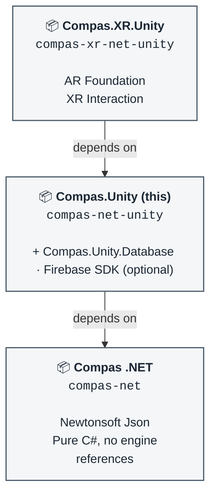

# COMPAS .NET for Unity

This repository is a C# library that enables and extends the functionalities of [COMPAS .NET](https://github.com/AHA-ArchitectureAndHumanAugmentation/compas-net) into Unity. While COMPAS .NET is engine-agnostic, this package is where COMPAS types meet Unity types: geometry conversions, meshes, `GameObject` transformations, Firebase and MQTT communication.

It is the second of three packages. Anything that does not need `UnityEngine` belongs in `compas-net`; anything that needs Unity but not XR belongs here; only XR-specific dependencies and code belong in `compas-xr-net-unity`.

| Repository | Package | Assembly |
| --- | --- | --- |
| [compas-net](https://github.com/AHA-ArchitectureAndHumanAugmentation/compas-net) | `com.compasdev.compas-net` | `Compas` |
| compas-net-unity (this one) | `com.compasdev.compas-net-unity` | `Compas.Unity` |
| [compas-xr-net-unity](https://github.com/AHA-ArchitectureAndHumanAugmentation/compas-xr-net-unity) | `com.compasdev.compas-xr-net-unity` | `Compas.XR.Unity` |

#### Dependency Graph


## Unity version support

COMPAS .NET for Unity is designed to support Unity 6000.0.57f1 and up.

## Installation in Unity

This repository **is** the Unity package: `package.json` sits at the repository root, so Unity can consume it directly through the **Package Manager**.

> [!IMPORTANT]
> This package depends on `com.compasdev.compas-net`, which is not on a Unity registry. Unity only resolves transitive dependencies from registries, so you must add **both** packages yourself, with `com.compasdev.compas-net` **first**.

> [!IMPORTANT]
> `com.compasdev.compas-net` in turn depends on
> [`dev.compas.compas-pb`](https://openupm.com/packages/dev.compas.compas-pb/),
> the protobuf runtime, which **is** on a registry (OpenUPM). Add the scoped
> registry below to your `manifest.json` so Unity can resolve it. Without it the
> install fails with an unresolved `dev.compas.compas-pb` dependency.

Note the asymmetry between the two: `compas-net` points at its **`src`** folder (`?path=/src`), while `compas-net-unity` points at its repository root, with no `?path` at all. That is where each `package.json` lives.

### Usage in a Unity project
For using this package in Unity, **no manual cloning is needed**. Simply tell your Unity project to clone it from git by adding the git addresses to your project's `Packages/manifest.json`:

**Option 1 - Package Manager UI:**

1. Window → Package manager → **+ → Add package from git URL...**
2. Add `git@github.com:AHA-ArchitectureAndHumanAugmentation/compas-net.git?path=/src` and click **`Install`**.
3. Wait for the import to finish, then repeat with `git@github.com:AHA-ArchitectureAndHumanAugmentation/compas-net-unity.git` and click **`Install`**.

**Option 2 - Editing the Unity project's `Packages/manifest.json` directly:**

```json
{
  "scopedRegistries": [
    {
      "name": "package.openupm.com",
      "url": "https://package.openupm.com",
      "scopes": [
        "dev.compas"
      ]
    }
  ],
  "dependencies": {
    "com.compasdev.compas-net": "git@github.com:AHA-ArchitectureAndHumanAugmentation/compas-net.git?path=/src",
    "com.compasdev.compas-net-unity": "git@github.com:AHA-ArchitectureAndHumanAugmentation/compas-net-unity.git"
  }
}
```
> [!TIP]
> Unity Package Manager (and `manifest.json`) can understand several semantics, you can learn more [here](https://docs.unity3d.com/6000.0/Documentation/Manual/upm-git.html).

### Development (within Unity)

Developing further the package requires a local clone of the repo, so that Unity can pick up the changes immediately.

1. Clone this repository, and `compas-net` alongside it.
2. Add both packages to your project's `Packages/manifest.json`.

**Option 1 - Package Manager UI:**

Window → Package manager → **+ → Add package from disk...** then select `compas-net/src/package.json`, and repeat for this repository's `package.json` at its root.

**Option 2 - Editing the `manifest.json` directly:**

```json
{
  "dependencies": {
    "com.compasdev.compas-net": "file:../../compas-net/src",
    "com.compasdev.compas-net-unity": "file:../../compas-net-unity"
  }
}
```

Both absolute and relative paths are supported. Relative paths are relative to the project's `Packages` folder.

> [!TIP]
> Packages added by path stay writable and under your own version control. Packages added by git URL are cached read-only by Unity, so if you cannot save a change, that entry is still a git URL.

Be sure to remove `bin` and `obj` folders from both repositories to avoid conflicts when building this project from Unity.

### In your code

```csharp
using Compas.Unity.Core.Geometry;
using Compas.Unity.Core.Conversions;
```
----

## Important Notes

### Firebase is optional

The database code sits behind its own assembly definition with a `FIREBASE_AVAILABLE` define constraint, driven by a version define on `com.google.firebase.app` (11.8.1). Without the Firebase SDK installed, that assembly simply does not compile in and the rest of the package works normally. See the section below if you need it.

### Assembly boundaries

`compas-net` builds into the `Compas` assembly, this repository builds into `Compas.Unity`, which references it. That boundary is deliberate: if a change to `compas-net` needs `UnityEngine`, it belongs in this repository instead.

### Meta files

`.meta` files are tracked in both repositories so Unity assigns the same GUIDs on every machine. Deleting them silently breaks scene and prefab references.

----

## Firebase Unity SDK versioning and installation

### Platform build support (Firebase only)

If you plan to use Firebase, ensure the following Unity build support modules are installed:

- Android Build Support
    - OpenJDK
    - Android SDK & NDK Tools
- iOS Build Support
- Universal Windows Platform Build Support

### Versioning notes

This project currently uses Firebase Unity SDK v11.8.1, pinned intentionally for stability and compatibility with the existing Unity workflow.

A complete list of currently supported Firebase Unity SDK versions and package combinations can be found here:
[LINK TO SUPPORTED DEPENDENCIES — TO BE ADDED]

Support for newer Firebase Unity SDK versions may be added in future releases after compatibility testing.

### Installing Firebase Unity SDK from .tgz packages

This project installs Firebase Unity SDK packages using local .tgz tarballs rather than the Unity registry. This ensures deterministic builds, avoids registry version drift, and allows the project to remain fully self-contained.

#### Recommended package location

All Firebase .tgz files should be stored inside the project directory, for example:

```
Packages/
  Embedded/
     com.google.external-dependency-manager-1.2.179.tgz
     com.google.firebase.app-11.8.1.tgz
     com.google.firebase.auth-11.8.1.tgz
     com.google.firebase.database-11.8.1.tgz
     com.google.firebase.firestore-11.8.1.tgz
     com.google.firebase.storage-11.8.1.tgz
```

Avoid storing Firebase packages in external locations (for example, Downloads/) or under Assets/, as this can lead to broken paths or unintended asset imports.

#### Package import order (important)

Firebase Unity packages have explicit inter-package dependencies and must be added in the correct order using:

Window → Package Manager → + → Add package from tarball…

Required import order:

1. External Dependency Manager
    com.google.external-dependency-manager-*.tgz
2. Firebase App (Core)
    com.google.firebase.app-*.tgz
3. Firebase Authentication
    com.google.firebase.auth-*.tgz
4. Additional Firebase services, as needed:
    - Realtime Database
    - Firestore
    - Cloud Storage
    - Analytics
    - App Check

For example: App → Auth → Storage

Attempting to install a dependent package (for example, Storage) before its dependencies (for example, Auth) will result in a package resolution error.