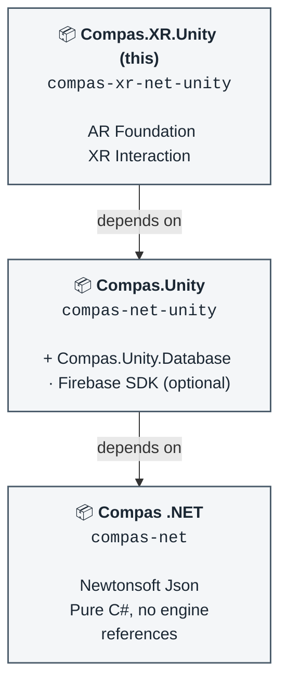

# COMPAS XR for Unity

This repository is the XR layer of COMPAS for Unity. It builds on [COMPAS .NET for Unity](https://github.com/AHA-ArchitectureAndHumanAugmentation/compas-net-unity) and holds everything that needs an XR runtime to work: AR Foundation, the XR Interaction Toolkit, and QR code scanning through the device camera.

It is the third of three packages. Anything that does not need `UnityEngine` belongs in `compas-net`; anything that needs Unity but not XR belongs in `compas-net-unity`; only XR-specific dependencies and code belong here.

| Repository | Package | Assembly |
| --- | --- | --- |
| [compas-net](https://github.com/AHA-ArchitectureAndHumanAugmentation/compas-net) | `com.compasdev.compas-net` | `Compas` |
| [compas-net-unity](https://github.com/AHA-ArchitectureAndHumanAugmentation/compas-net-unity) | `com.compasdev.compas-net-unity` | `Compas.Unity` |
| compas-xr-net-unity (this one) | `com.compasdev.compas-xr-net-unity` | `Compas.XR.Unity` |

#### Dependency Graph


## Unity version support

COMPAS XR for Unity is designed to support Unity 6000.0.57f1 and up.

## Installation in Unity

This repository **is** the Unity package: `package.json` sits at the repository root, so Unity can consume it directly through the **Package Manager**.

> [!IMPORTANT]
> This package depends on `com.compasdev.compas-net-unity`, which in turn depends on `com.compasdev.compas-net`. Neither is on a Unity registry, and Unity only resolves transitive dependencies from registries, so you must add **all three** packages yourself, in the order below.

Note the asymmetry between them: `compas-net` points at its **`src`** folder (`?path=/src`), while the two Unity packages point at their repository roots, with no `?path` at all. That is where each `package.json` lives.

The XR dependencies themselves — AR Foundation and the XR Interaction Toolkit — **are** on the Unity registry, so those resolve automatically.

### Usage in a Unity project
For using this package in Unity, **no manual cloning is needed**. Simply tell your Unity project to clone it from git by adding the git addresses to your project's `Packages/manifest.json`:


**Option 1 - Package Manager UI:**

1. Window → Package manager → **+ → Add package from git URL...**
2. Add `git@github.com:AHA-ArchitectureAndHumanAugmentation/compas-net.git?path=/src` and click **`Install`**.
3. Wait for the import to finish, then repeat with `git@github.com:AHA-ArchitectureAndHumanAugmentation/compas-net-unity.git`.
4. Wait again, then repeat with `git@github.com:AHA-ArchitectureAndHumanAugmentation/compas-xr-net-unity.git`.

**Option 2 - Editing the Unity project's `Packages/manifest.json` directly:**

```json
{
  "dependencies": {
    "com.compasdev.compas-net": "git@github.com:AHA-ArchitectureAndHumanAugmentation/compas-net.git?path=/src",
    "com.compasdev.compas-net-unity": "git@github.com:AHA-ArchitectureAndHumanAugmentation/compas-net-unity.git",
    "com.compasdev.compas-xr-net-unity": "git@github.com:AHA-ArchitectureAndHumanAugmentation/compas-xr-net-unity.git"
  }
}
```
> [!TIP]
> Unity Package Manager (and `manifest.json`) can understand several semantics, you can learn more [here](https://docs.unity3d.com/6000.0/Documentation/Manual/upm-git.html).

### Development (within Unity)

Developing further the package **requires a local clone of the repo** (and the dependency repos), so that Unity can pick up the changes immediately.

1. Clone this repository, and `compas-net` and `compas-net-unity` alongside it.
2. Add all three packages to your project's `Packages/manifest.json`.

**Option 1 - Package Manager UI:**

1. Window → Package manager → **+ → Add package from disk...** 
2. Select `compas-net/src/package.json`
3. Repeat for `compas-net-unity/package.json` 
4. Repeat for this repository's `package.json`.

**Option 2 - Editing the `manifest.json` directly:**

```json
{
  "dependencies": {
    "com.compasdev.compas-net": "file:../../compas-net/src",
    "com.compasdev.compas-net-unity": "file:../../compas-net-unity",
    "com.compasdev.compas-xr-net-unity": "file:../../compas-xr-net-unity"
  }
}
```

Both absolute and relative paths are supported. Relative paths are relative to the project's `Packages` folder.

> [!TIP]
> Packages added by path stay writable and under your own version control. Packages added by git URL are cached read-only by Unity, so if you cannot save a change, that entry is still a git URL.

Be sure to remove `bin` and `obj` folders from all repositories to avoid conflicts when building this project from Unity.

### In your code

`SimpleQRScanner` is a `MonoBehaviour`: add it to a GameObject, assign a `RawImage` for the camera preview, and subscribe to its static event.


----

## Important Notes for Development

### What belongs in this package

Only code with an XR dependency. The assembly definition references `Unity.XR.ARFoundation`, `Unity.XR.Interaction.Toolkit`, `Unity.XR.ARSubsystems`, `Unity.XR.CoreUtils` and `Unity.Mathematics`, alongside `Compas` and `Compas.Unity`. If a change needs none of the XR assemblies, it belongs one layer down in `compas-net-unity`.

### Assembly boundaries

The dependency chain runs one way: `Compas` → `Compas.Unity` → `Compas.XR.Unity`. Nothing lower in the chain may reference something higher, which is what keeps `compas-net` free of engine references and `compas-net-unity` usable in non-XR projects.

### Bundled plugins

`Runtime/Plugins/zxing.unity.dll` provides the barcode and QR decoding used by `SimpleQRScanner`. It is committed to the repository rather than pulled from a registry, so no extra install step is needed.

### Meta files

`.meta` files are tracked in all three repositories so Unity assigns the same GUIDs on every machine. Deleting them silently breaks scene and prefab references.

----

## XR platform setup

The packages install through the Package Manager, but an XR build also needs Editor modules and a platform provider that the Package Manager cannot install for you.

### Platform build support

Install these Unity build support modules through Unity Hub, for your target platform:

- Android Build Support
    - OpenJDK
    - Android SDK & NDK Tools
- iOS Build Support

### Enabling a provider plug-in

AR Foundation is an abstraction layer: it needs a provider for the platform you are building to. Install the provider for your target through the Package Manager, then enable it under **Project Settings → XR Plug-in Management**:

- **Android** — ARCore
- **iOS** — ARKit

Without a provider enabled for the active build target, AR Foundation compiles but finds no camera or tracking subsystem at runtime.

### Camera permissions

QR scanning reads frames from the device camera, so the build needs camera permission:

- **Android** — declared by the ARCore provider; verify `CAMERA` is present in the generated manifest.
- **iOS** — set **Camera Usage Description** in **Project Settings → Player → Other Settings**. iOS builds are rejected without it.
