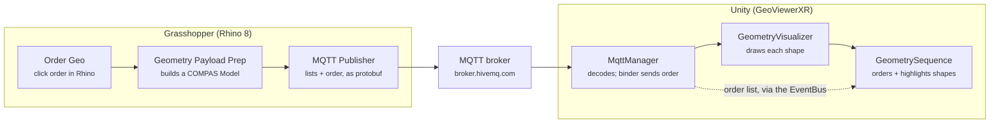
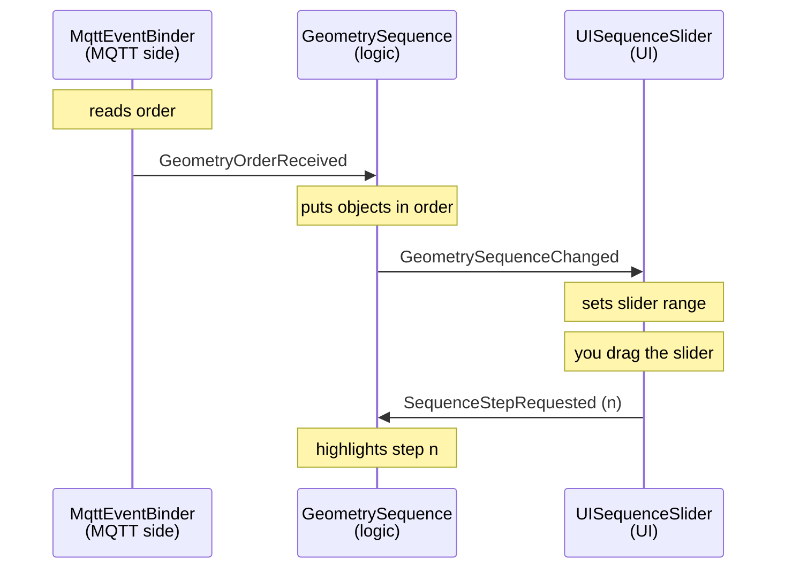

# Geometry Order & Sequence Slider

How the clicked order of geometry travels from Rhino/Grasshopper to Unity, and how the Sequence Slider steps through it.

*Last updated: 2026-09-27*

## Overview

Geometry gets its order by clicking it in Rhino. That order travels with the geometry over MQTT to Unity, where a slider steps through it one object at a time.



Grasshopper sends the shapes plus an `order` list. In Unity, the GeometryVisualizer draws the shapes and GeometrySequence uses the order list to line them up. A slider in the UI steps through them.

## What changed where

Three Grasshopper scripts, one shared Python environment and new Unity scripts. The current Rhino and Grasshopper files are in the repo under [`gh/`](../gh/): `ARchitecture_rhino2unity_CT_20260924.3dm` and `ARchitecture_rhino2unity_CT_20260927.gh`.

| Where | File / component | What it does now |
| --- | --- | --- |
| Grasshopper | **Order Geo** (Python) | Click geometry in Rhino to set its order. Colours it and draws the numbers. Takes Breps, meshes, extrusions, surfaces and SubDs. Outputs `order` and `geometry` (sorted). A Boolean Toggle on `pick` switches itself off after Enter. |
| Grasshopper | **Geometry Payload Prep** (Python) | Turns the sorted geometry into a COMPAS Model: one element per object, each with `order`, `kind` (box, cylinder, sphere, mesh, point) and `shape`. Clean boxes, cylinders and spheres stay primitives; everything else becomes a mesh. |
| Grasshopper | **MQTT Publisher** (Python) | Reads the Model and sends the usual lists (`boxes`, `cylinders`, `meshes`, ...) plus an `order` list and a timestamp `ts`, as protobuf. New `preview` output shows what is sent. |
| Grasshopper | Canvas labels | `Bricks` renamed to `Geometry`, `order bricks` to `order geometry`. |
| Python environment | Header of every Python component | `# venv: venv-compas-xr2.2` and ONE line `# r: compas==2.13.0, compas_model==0.9.3, compas_eve==2.3.0, compas_pb==1.0.0`. Must be identical everywhere. |
| Unity | `Assets/Scripts/MqttEventBinder.cs` (changed) | Still the only script holding the MqttManager. Now also passes the `order` list of incoming messages on as the event `GeometryOrderReceived`. |
| Unity | `Assets/Scripts/Events/` (3 new) | `GeometryOrderReceived` (order arrived), `GeometrySequenceChanged` (objects lined up, with their count), `SequenceStepRequested` (UI asks for step n). |
| Unity | `Assets/Scripts/GeometrySequence.cs` (new) | Logic, next to GeometryBeautifier: lines the drawn objects up in order, shows the order, highlights the requested step. No UI, no MQTT. |
| Unity | `Assets/Scripts/UI/UISequenceSlider.cs` (new) | UI, like UIOptionsMenu: a Slider and a TextMeshPro label. Sizes itself from the sequence and asks for steps. |

The environment rule matters: Rhino installs every `# r:` line as its own step. Two lines that both pull in compas crash the install and Rhino marks the environment as corrupted.

## The message

Grasshopper sends one dictionary: the shapes sorted into lists by type, plus an `order` list that says which shape comes when. Example with five objects:

```
{ "boxes":     [Box, Box, Box],
  "cylinders": [Cylinder],
  "meshes":    [Mesh],
  "spheres":   [], "points": [],
  "order":     ["boxes[0]", "meshes[0]", "boxes[1]", "cylinders[0]", "boxes[2]"],
  "radius": 1.0, "height": 2.0, "compas_version": "2.13.0",
  "ts": 1790526091.43 }
```

- `order[i]` points at a shape: `order[3] = "cylinders[0]"` means object number 3 is the first cylinder.
- `ts` changes on every send, so Unity never ignores a repeated message.
- `radius` and `height` describe the first cylinder or sphere only.

**How it travels.** The dictionary is sent as protobuf, not as JSON text. Protobuf is a compact binary format: both sides share a schema (compas_pb) that says what a Box, Cylinder or Mesh looks like, so only the values go over the wire. compas_eve does the sending over MQTT.

**Where to read it.** In Grasshopper, the Publisher's `preview` output shows the list sizes and the order. With `PREVIEW_FULL = True` at the top of the script it also shows the complete message, decoded back from the exact bytes that are sent. In that view protobuf leaves out zeros: `"point": {}` means (0, 0, 0).

## How Unity handles it

Five components share the work in the **GeoViewer** scene. They follow the project's rule: UI and logic never call each other, they talk through events on the `EventBus`, and only `MqttEventBinder` touches the MqttManager.

| Component | On GameObject | Job |
| --- | --- | --- |
| `MqttManager` (package) | **MQTT** | Subscribes to the topic, receives the protobuf bytes and decodes them into C# objects: dictionaries, lists and shapes. |
| `MqttEventBinder` (ours) | **MQTT** | Takes the `order` list out of each message and raises `GeometryOrderReceived`. |
| `GeometryVisualizer` (package) | **GeometryVisualizer** | Draws every shape in the message. Each object is named after its place in the message, e.g. `...to_unity.boxes[0]`. Ignores everything that is not a shape. |
| `GeometrySequence` (ours) | **GeometryVisualizer** | On `GeometryOrderReceived`: looks up the drawn objects and puts them in order, then raises `GeometrySequenceChanged`. On `SequenceStepRequested`: highlights that step. |
| `UISequenceSlider` (ours) | **Sequence Slider** under UI_CompasXR | On `GeometrySequenceChanged`: sets the slider range. When moved: raises `SequenceStepRequested` and updates the "3 / 12" label. |



Read it top to bottom. The top part runs once per message from Grasshopper; the bottom part (drag, highlight) runs every time the slider moves. Because the scripts only share events, the slider can be replaced by any other input that raises `SequenceStepRequested`.

**Slider behaviour at value n:** objects before n keep their colour, object n turns orange (highlight), objects after n turn see-through (ghost) or are hidden.

**Where the order is visible, even without the slider:**

- **Console:** one line per message listing the sequence, e.g. `0 boxes[0]`, `1 meshes[0]`.
- **Hierarchy:** objects are renamed `#00 boxes[0]`, `#01 meshes[0]`, ... and sorted top to bottom in clicked order.
- **Inspector:** on GeometrySequence, *Received (read only) > Ordered Elements* lists the objects in order.
- **Scene view:** the order number sits on each object, like in Rhino (Gizmos on).

All four work without the slider. The slider only adds the highlight.

## Guide: setting up the slider by hand

About 10 minutes in the Unity editor, no code. You create two materials, add the logic component, then build the slider UI and connect it. The sizes match the existing UI (Create button 40 x 40, button text size 9).

**Before you start:** open the **GeoViewer** scene and wait until the scripts have compiled: no spinner bottom right, no red lines in the Console.

1. **Create the highlight material.**
   - Project window: open `Assets/Materials`, right-click > **Create > Material**, name it `Sequence_Highlight`.
   - Inspector: Shader stays *Universal Render Pipeline/Lit*. Click the colour next to **Base Map** and pick a strong colour, e.g. orange.
   - This is the colour of the current step.
2. **Create the ghost material.**
   - Same way, name it `Sequence_Ghost`.
   - Set **Surface Type** to *Transparent*. Pick a light grey Base Map colour and pull its **A** (alpha) down to about 40.
   - This is how steps after the current one look. Skip it if they should be hidden instead.
3. **Add the logic: GeometrySequence.**
   - Hierarchy: select **GeometryVisualizer**. Inspector: **Add Component**, search `Geometry Sequence`, add it.
   - Drag *Sequence_Highlight* into **Highlight Material** and *Sequence_Ghost* into **Ghost Material**. Leave **Built Material** empty so finished steps keep their palette colour.
   - **Visualizer** can stay empty: it finds the GeometryVisualizer on the same object.
   - It sits next to GeometryBeautifier because, like it, it works on the objects this visualizer draws.
4. **Check the MQTT object.**
   - Select **MQTT**. It already has **Mqtt Event Binder**; nothing to add.
   - The binder is what passes the `order` list on. It is the only script that touches the MqttManager.
5. **Create the slider.**
   - Hierarchy: right-click **UI_CompasXR** > **UI > Slider**. Rename it `Sequence Slider`.
   - Rect Transform: anchor preset *bottom center* (Alt+Shift click), Pos X `0`, Pos Y `100`, Width `300`, Height `20`. That puts it just under the Create button.
   - Leave Min, Max and Value alone: the script sets them when a message arrives.
6. **Add the UI script to the slider.**
   - With *Sequence Slider* selected: **Add Component**, search `UI Sequence Slider`, add it.
   - Drag the *Sequence Slider* object itself into its **Slider** field.
7. **Add the step label (optional).**
   - Right-click *Sequence Slider* > **UI > Text - TextMeshPro**. Rename it `Step Label`.
   - Anchor preset *top center*, Pos Y `16`, Width `100`, Height `20`. Font Size `9`, alignment centred, same font asset as the *Send to Rhino* button text.
   - Drag *Step Label* into the **Step Label** field of UI Sequence Slider.
8. **Save the scene** with Ctrl+S.
9. **Test it.**
   - Press Play and connect as usual.
   - In Grasshopper, set an order with Order Geo and send.
   - Check the Console line from GeometrySequence and the renamed objects in the Hierarchy, then drag the slider.

Why two components: GeometrySequence is logic and works without any UI, e.g. on a headset with another input. UISequenceSlider is only the phone UI. They never reference each other; the EventBus connects them, like the other UI scripts.

## Checking and troubleshooting

Compare the two ends first: the Grasshopper `preview` lists what went out, the Unity Console lists what arrived. If both show the same order, the pipeline works.

| Symptom | Likely cause | What to do |
| --- | --- | --- |
| Rhino: *Environment "venv-compas-xr2.2" is corrupted* | Python components have different `# r:` lines | Make every header identical (one `# r:` line), close Rhino, delete the `venv-compas-xr2.2-...` folder in `%USERPROFILE%\.rhinocode\py39-rh8\site-envs`, reopen. |
| Unity Console: `rendered 0 geometries` | The message holds no shape lists Unity knows | Check the Publisher `preview`: it should list `boxes`, `meshes`, ... with items. |
| No GeometrySequence line in the Console | Message has no `order`, or GeometrySequence is missing | Check `preview` shows an `order` list; check step 3 of the guide. |
| Console: `(not drawn)` next to an entry | Unity could not draw that shape | Look at that object in Grasshopper; it may be an unsupported type. |
| Slider greyed out | Fewer than two objects in the sequence | Send at least two objects with an order. |
| Slider moves, nothing lights up | No highlight material, or UISequenceSlider's Slider field is empty | Steps 3 and 6 of the guide. |
| Ghost objects look solid | Ghost material not transparent | Surface Type *Transparent* and a low alpha on Sequence_Ghost. |
| Label shows `-` | No sequence received yet | Send from Grasshopper. |
| `NullReferenceException` in M2MqttUnityClient line 236 | Known race in the package's MQTT client | Happens now and then, independent of our code. Fix prepared, see Open items. |

To see the complete decoded message in Unity, set a breakpoint in the package's `MqttManager.cs` at line 228 and inspect `decodedMessage` in the debugger.

## Open items

- [ ] **MQTT client race fix.** Add a lock and a null check to `Runtime/Dependencies/M2MqttUnity/Scripts/M2MqttUnityClient.cs` in the compas-net-unity repo (patched file prepared). Editing the copy in `Library/PackageCache` does not last: Unity re-downloads it.
- [ ] **Publisher `preview` output.** Add an output named `preview` to the MQTT Publisher component and connect a Panel.
- [ ] **Own broker or topic.** broker.hivemq.com is public; anyone who knows the topic can read or send.
